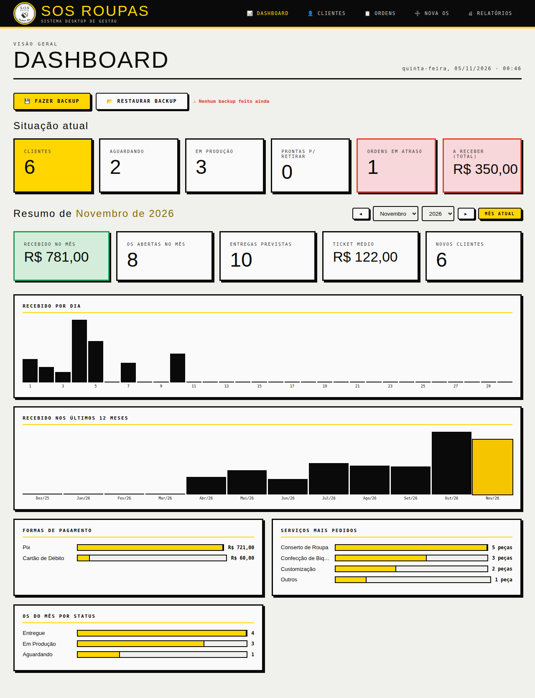
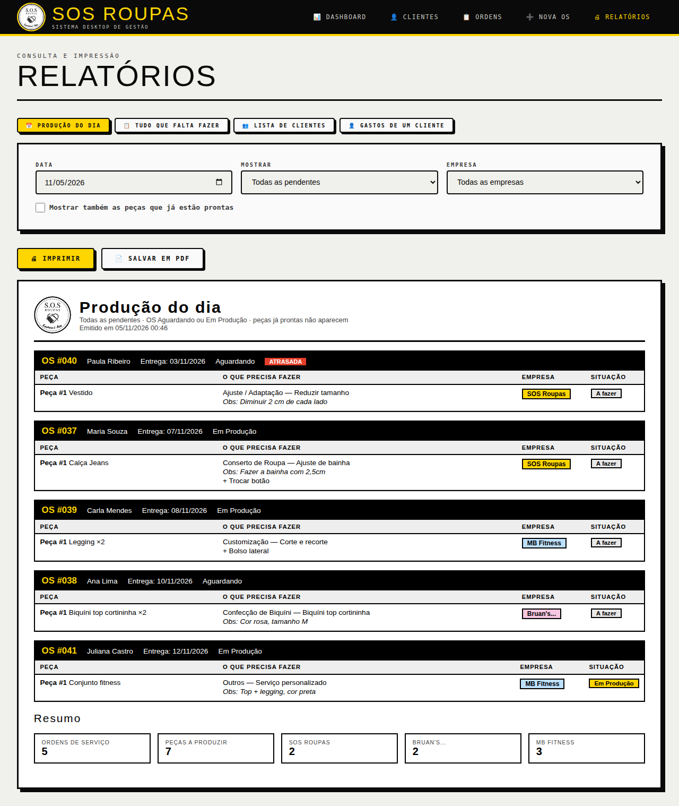
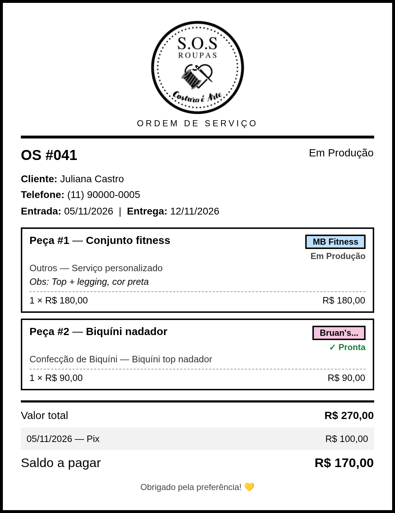
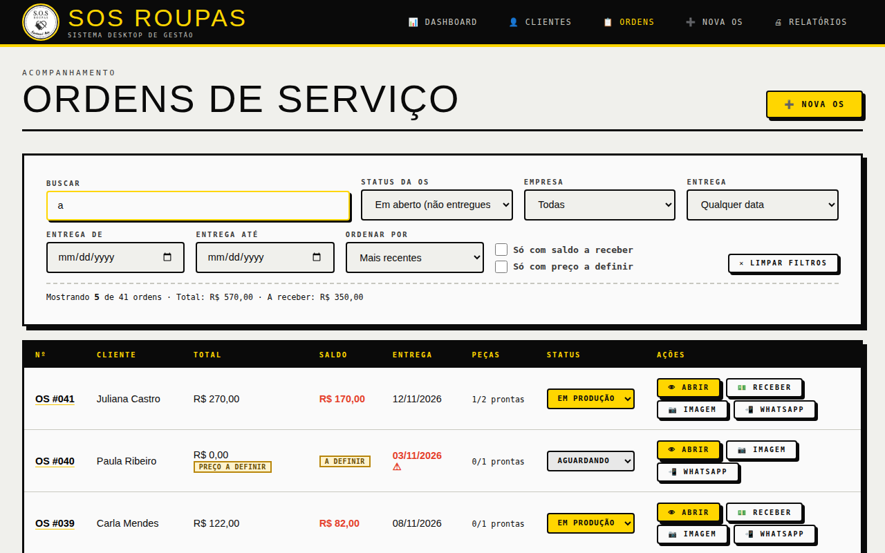
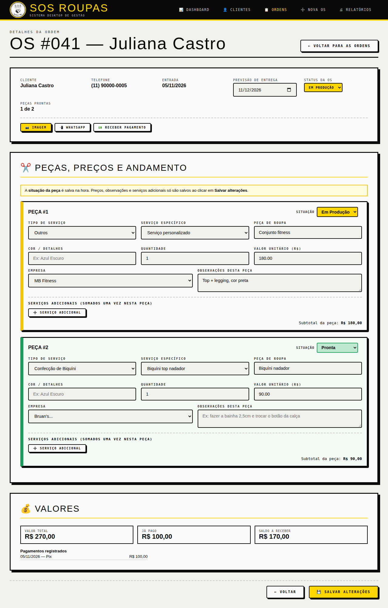
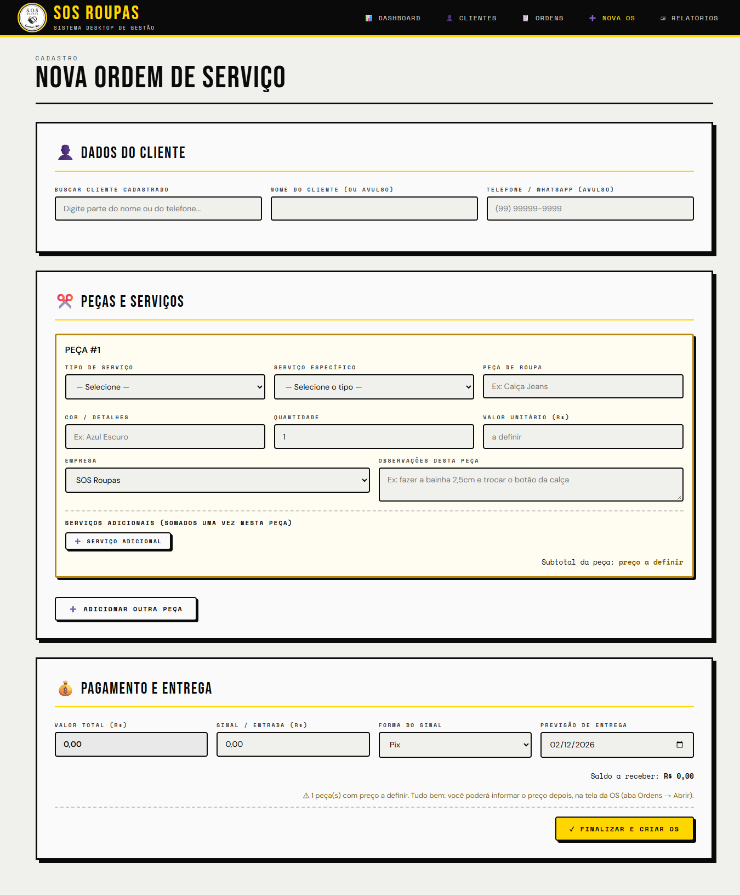
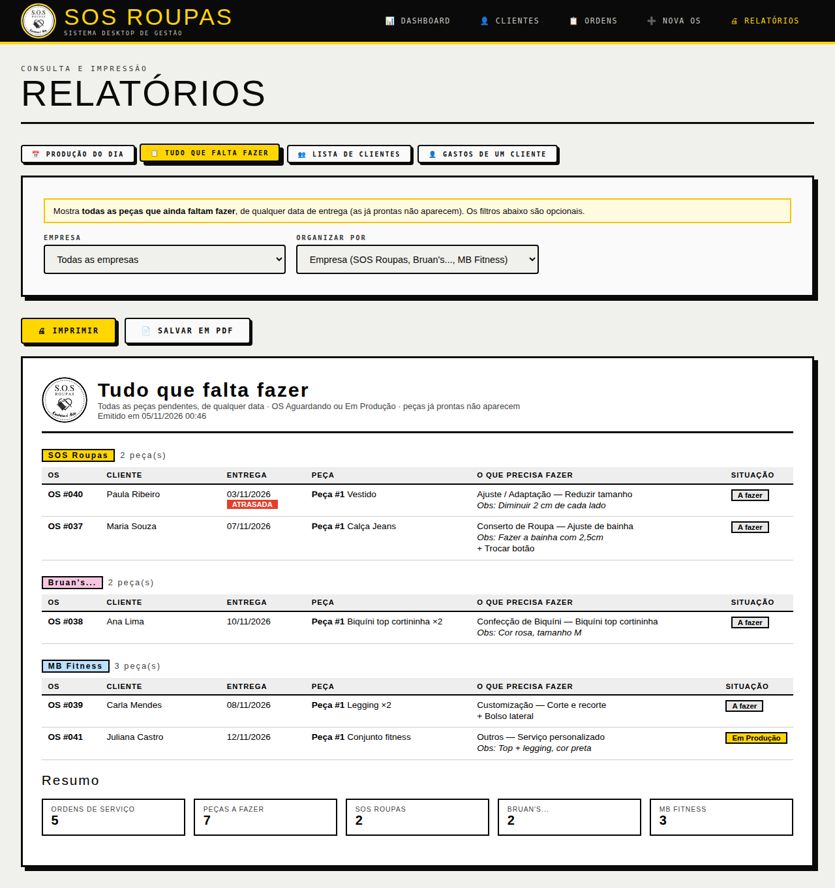
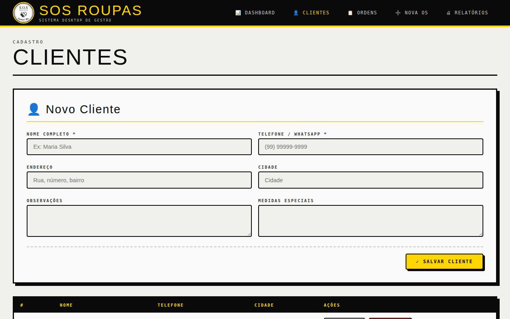
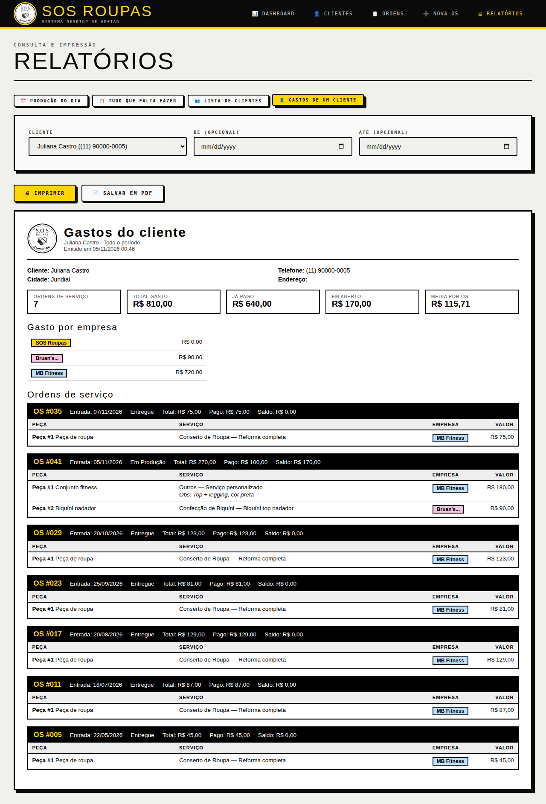

# SOS Roupas — Sistema de Gestão

Sistema **desktop (Windows)** para gerenciar uma loja de costura e conserto de roupas: cadastro de clientes, ordens de serviço (OS), controle de pagamentos, relatórios impressos e comprovantes em imagem para enviar por WhatsApp.

Funciona **100% no computador**: sem internet obrigatória, sem conta, sem nuvem. Os dados ficam em um arquivo local e podem ser salvos em backup num pendrive.

> **Sobre este projeto.** Foi criado a partir das necessidades reais do negócio da minha família (uma loja de conserto e confecção de roupas, que atende sob três marcas: *SOS Roupas*, *Bruan's...* e *MB Fitness*). O código foi desenvolvido **com auxílio de IA (Claude, da Anthropic)**. Os requisitos, as decisões de funcionamento, os testes de uso e a validação no dia a dia da loja são meus.

<p align="center">
  
</p>

> Todas as imagens deste repositório usam **dados fictícios** (nomes e telefones inventados).

---

## Funcionalidades

### 📊 Dashboard
- Situação atual: clientes, OS aguardando, em produção, prontas para retirar, **em atraso** e **total a receber**.
- **Seletor de mês** (setas, mês e ano) com virada de ano correta (dezembro → janeiro); a tela acompanha o mês atual sozinha à meia-noite.
- Resumo do mês: valor recebido, OS abertas, entregas previstas, ticket médio e novos clientes.
- Gráficos: recebido por dia, recebido nos últimos 12 meses, formas de pagamento, serviços mais pedidos e OS por status.
- **Backup e restauração** com aviso quando faz 7 dias ou mais sem backup.

### 👤 Clientes
- Cadastro com nome, telefone/WhatsApp, endereço, cidade, observações e medidas.
- Edição e exclusão. Ao **editar** nome/telefone, as OS desse cliente são atualizadas junto. Ao **excluir**, o histórico das OS é preservado.

### ➕ Nova OS
- **Busca de cliente** por nome ou telefone (ignora maiúsculas e acentos) ou cadastro de cliente avulso.
- Várias peças por OS, cada uma com: tipo e serviço, peça, cor, quantidade, valor, **empresa** (SOS Roupas / Bruan's... / MB Fitness) e **observações**.
- **Serviços adicionais** por peça (ex.: "fazer a bainha 2,5cm", "trocar o botão"), com valor opcional.
- **Preço pode ficar "a definir"**: dá para criar a OS sem saber quanto vai cobrar e informar o valor depois (o sinal pode até passar do total provisório).
- Subtotal por peça, total da OS, sinal/entrada com forma de pagamento e saldo calculado na hora.

### 📋 Ordens de serviço
- **Busca e filtros:** por nº da OS, cliente, telefone, peça, cor ou observação (sem diferenciar acentos); por status da OS, empresa, atraso/entregas de hoje ou da semana, período de entrega, "só com saldo a receber" e "só com preço a definir"; com ordenação e contador com o total e o valor a receber do que está filtrado.
- **Tela da OS (visualizar e editar):** altere o preço de cada peça, a quantidade, a observação, a empresa, os serviços adicionais e a previsão de entrega. O total e o saldo se atualizam ao vivo e o sistema avisa se você sair sem salvar.
- **Situação de cada peça** (A fazer, Em Produção, Pronta), salva na hora. Se a produção parar no meio, ao voltar o sistema mostra o que já foi feito e o que falta. O status da OS acompanha as peças automaticamente (todas prontas = "Pronto").
- Lista com saldo, progresso das peças (ex.: 2/3 prontas), atrasadas em destaque e **status** da OS editável: Aguardando, Em Produção, Pronto, Entregue, Cancelado.
- **Receber pagamento** do saldo (Pix, dinheiro, cartão), na lista ou dentro da OS.
- **Imagem da OS (PNG)** com logo, peças numeradas, empresa e situação de cada peça, observações, serviços adicionais e pagamentos.
- **WhatsApp:** copia a imagem da OS e abre a conversa do cliente; basta colar (`Ctrl+V`) e enviar.

### 🖨 Relatórios (imprimir ou salvar em PDF)
- **Produção do dia:** quais peças ainda precisam ser feitas (as já prontas ficam de fora, a menos que você peça para mostrar), o que fazer em cada uma, de qual empresa e a situação, com filtro por data e por empresa e resumo por empresa.
- **Tudo que falta fazer:** todas as peças pendentes, de **qualquer data de entrega** (as já prontas não aparecem), por OS ou organizadas por empresa, com filtro opcional de empresa.
- **Lista de clientes:** com número de OS e total gasto, ordenável por nome, por quem mais gastou ou por atendimento mais recente.
- **Gastos de um cliente:** total gasto, quanto já pagou, em aberto, média por OS e gasto por empresa, com filtro de período.

<p align="center">
  
  
</p>

<details>
<summary>Mais telas</summary>

| Ordens (busca e filtros) | Tela da OS (preços e situação das peças) |
|---|---|
|  |  |

| Nova OS | Tudo que falta fazer |
|---|---|
|  |  |

| Clientes | Gastos de um cliente |
|---|---|
|  |  |

</details>

---

## Instalação (para usar na loja)

1. Baixe o instalador `Instalador-SOS-Roupas-X.Y.Z.exe` na aba **[Releases](../../releases)**.
2. Dê dois cliques. Ele instala sozinho e cria o atalho na Área de Trabalho.
3. Se o Windows mostrar *"O Windows protegeu o computador"*, clique em **Mais informações → Executar assim mesmo**. Isso acontece porque o instalador não tem assinatura digital paga; o código-fonte está todo aberto neste repositório.

**Requisitos:** Windows 10 ou 11, 64 bits. Não precisa instalar Node.js nem nada além do instalador.

## Rodar em modo de desenvolvimento

Precisa do [Node.js](https://nodejs.org) (versão LTS, 22 ou superior).

```bash
git clone https://github.com/m-montoro/sos-roupas.git
cd sos-roupas
npm install
npm start
```

No Windows também dá para abrir o `iniciar.bat` com dois cliques.

## Gerar o instalador

```bash
npm run dist
```

O instalador é criado na pasta `dist/`. Ou dê dois cliques em `gerar-instalador.bat`. Passo a passo completo em [COMO-GERAR-O-INSTALADOR.md](COMO-GERAR-O-INSTALADOR.md).

---

## Tecnologias

| Parte | Tecnologia |
|---|---|
| Aplicativo desktop | [Electron](https://www.electronjs.org/) |
| Banco de dados | SQLite via [better-sqlite3](https://github.com/WiseLibs/better-sqlite3) |
| Interface | HTML, CSS e JavaScript puro (sem framework) |
| Imagem da OS | [html-to-image](https://github.com/bubkoo/html-to-image) |
| Instalador | [electron-builder](https://www.electron.build/) |

## Estrutura do projeto

```
├── main.js                 # processo principal do Electron: janela, banco, relatórios, backup
├── database.js             # criação das tabelas e migrações do banco
├── src/
│   ├── index.html          # telas
│   ├── app.js              # lógica da interface
│   ├── styles.css          # estilos (inclui o estilo de impressão)
│   └── logo.png
├── assets/                 # ícones do aplicativo
├── docs/screenshots/       # imagens deste README (dados fictícios)
├── iniciar.bat             # abre o sistema (Windows)
└── gerar-instalador.bat    # gera o instalador (Windows)
```

---

## Dados, privacidade e segurança

- **Os dados nunca saem do computador.** Não existe servidor, conta, login na nuvem nem telemetria.
- O banco fica em `%APPDATA%\sos-roupas-app\sos_roupas.db`. Desinstalar o programa **não apaga** os dados.
- O único acesso à internet é opcional: as fontes do Google (sem nenhum dado de clientes) e o botão de WhatsApp, que abre o link `wa.me` no navegador **somente quando você clica**.
- Proteções implementadas: política de segurança de conteúdo (CSP), bloqueio de navegação e janelas externas, permissões do navegador negadas, consultas SQL parametrizadas, texto escapado na tela e validações no processo principal.
- O repositório tem um `.gitignore` para **não publicar bancos, backups, PDFs/imagens de clientes, chaves e instaladores**.

⚠️ **Limitações importantes:** o banco e os backups **não são criptografados** e o app não tem senha de acesso. Quem acessar o Windows do usuário ou o pendrive consegue abrir os dados. Recomenda-se usar BitLocker (inclusive no pendrive) e conta de usuário com senha. Detalhes e como reportar falhas em [SECURITY.md](SECURITY.md).

## Backup e restauração

- **💾 Fazer backup** (Dashboard) gera um único arquivo `.db`, verificado após salvar, ideal para o pendrive.
- **📂 Restaurar backup** substitui os dados atuais pelos do arquivo escolhido e reinicia o sistema. Antes disso, guarda automaticamente uma cópia de segurança dos dados atuais.
- Para levar os dados de um computador para outro: faça o backup no primeiro e restaure no segundo.

## Limitações 

- Apenas Windows 64 bits (Windows 10 ou 11).
- Um único usuário por vez; não há acesso em rede nem sincronização entre computadores.
- O WhatsApp não permite anexar arquivo por link: por isso a imagem é copiada e você cola na conversa.
- O instalador não é assinado digitalmente.
- A numeração das OS é sequencial e **não reinicia** a cada ano.

## Ideias para o futuro

- Senha de acesso e criptografia do banco/backups.
- Fontes embutidas (uso 100% offline sem nenhuma requisição externa).
- Testes automatizados no repositório.
- Migrar a interface para o modelo `preload` + `contextBridge` do Electron (isolamento total).

## Contribuindo

Sugestões e correções são bem-vindas via *Issues* e *Pull Requests*. **Nunca envie dados reais de clientes** (nem em prints, nem em arquivos de exemplo). Use sempre dados inventados.

## Licença

O **código** está sob a licença [MIT](LICENSE).
O **nome e a logo "S.O.S Roupas"** (e as marcas *Bruan's...* e *MB Fitness*) pertencem aos seus donos e **não** estão cobertos pela licença MIT: não os use como se fossem seus.
